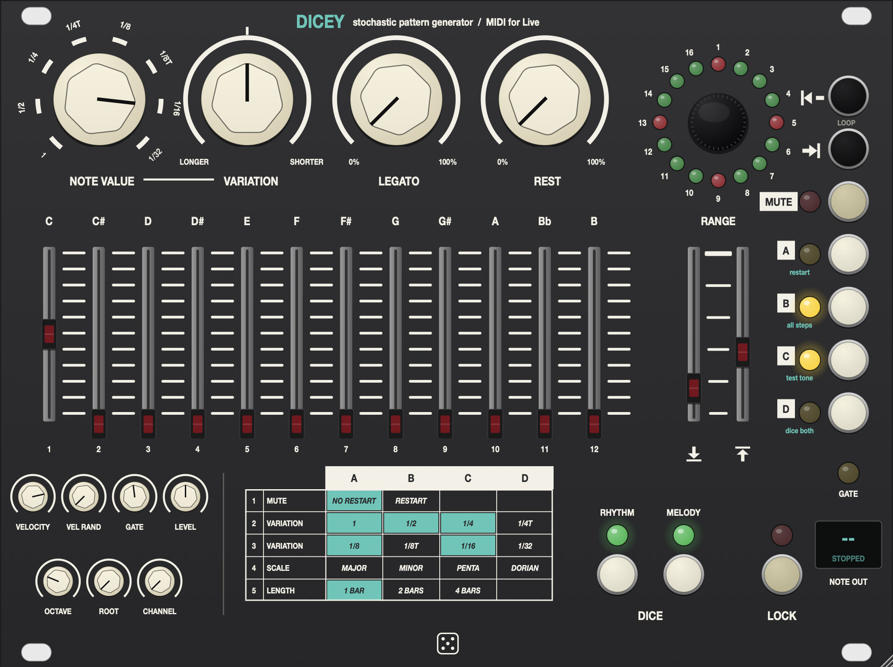

# Dicey

A stochastic melody and rhythm generator for Ableton Live. It sends monophonic
MIDI to any instrument and follows Live's transport and tempo.



A personal project: a VST3 plugin for macOS, Windows and Linux.

## Building

The project is self-contained. CMake downloads JUCE 8.0.9, which includes the
VST3 SDK, the first time you configure, so there's nothing else to fetch by hand.

**Every platform needs:**

- CMake 3.22 or newer
- Git
- A C++20 compiler (see each platform below)
- An internet connection for the first configure

Every build has the same three steps: configure, build, test. The first
configure takes a few minutes while JUCE downloads; after that, builds are
incremental.

### macOS

You need the Xcode command line tools and CMake:

```sh
xcode-select --install
brew install cmake          # or the installer from cmake.org
```

Then build:

```sh
cd path/to/dicey
cmake -B build -DCMAKE_BUILD_TYPE=Release
cmake --build build --config Release -j
```

The build installs the plugin to `~/Library/Audio/Plug-Ins/VST3/Dicey.vst3`.

- It builds for your Mac's own processor, Apple silicon or Intel. For a
  universal binary, add `-DCMAKE_OSX_ARCHITECTURES="arm64;x86_64"` to the
  configure step.
- Near the end of the build you'll see lines like *"Replacing invalid signature
  with ad-hoc signature"*. They're normal: JUCE re-signs the plugin after adding
  its metadata. An ad-hoc signature is all you need on your own machine.

### Windows

You need:

- **Visual Studio 2022** (Community is fine) with the **Desktop development
  with C++** workload. It includes a recent CMake.
- **Git for Windows**.

Open **Developer PowerShell for VS 2022**, then:

```powershell
cd path\to\dicey
cmake -B build -G "Visual Studio 17 2022" -A x64
cmake --build build --config Release
```

The plugin is built to `build\Dicey_artefacts\Release\VST3\Dicey.vst3`. That's
a folder; copy the whole folder into `C:\Program Files\Common Files\VST3`.

To have the build copy it there for you, run the terminal as Administrator and
add `-DDICEY_COPY_PLUGIN=ON` to the configure step. Writing to that folder needs
administrator rights, which is why the copy is off by default on Windows.

### Linux

Ableton Live doesn't run on Linux, but the plugin works in any VST3 host that
can route a plugin's MIDI output: Bitwig Studio, REAPER, Ardour and others.

You need GCC 11+ or Clang 14+. On Debian or Ubuntu, install the toolchain and
JUCE's dependencies:

```sh
sudo apt install build-essential cmake git pkg-config \
    libasound2-dev libfreetype-dev libfontconfig1-dev libgl1-mesa-dev \
    libx11-dev libxcomposite-dev libxcursor-dev libxext-dev \
    libxinerama-dev libxrandr-dev libxrender-dev
```

On other distributions, install the equivalent `-devel` packages.

Then build:

```sh
cd path/to/dicey
cmake -B build -DCMAKE_BUILD_TYPE=Release
cmake --build build -j
```

The build installs the plugin to `~/.vst3/Dicey.vst3`.

### Running the tests

The engine tests are built along with the plugin. They're plain C++ with no
JUCE, and they run on any platform:

```sh
ctest --test-dir build -C Release --output-on-failure
```

### Build options

| Option | Default | What it does |
|---|---|---|
| `DICEY_COPY_PLUGIN` | `ON` (`OFF` on Windows) | Copy the plugin into the system VST3 folder after each build |
| `DICEY_JUCE_DIR` | *(empty)* | Use a local JUCE checkout instead of downloading one. Useful offline; it must be JUCE 8.0.9 |
| `CMAKE_OSX_ARCHITECTURES` | your Mac's processor | `"arm64;x86_64"` builds a universal binary |

Pass any of these at configure time, for example
`cmake -B build -DDICEY_JUCE_DIR=/path/to/JUCE`.

### Building in the cloud (GitHub Actions)

`.github/workflows/build.yml` builds the plugin on GitHub's machines. It's the
easy way to get a Windows build from a Mac. It only runs when you start it:

1. Push the repo to GitHub.
2. Go to the **Actions** tab, choose **Build plugin**, then **Run workflow**.
3. Tick the platforms you want and press **Run workflow**.
4. When the run finishes, open it. The plugins are listed under **Artifacts**
   at the bottom of the summary page, and GitHub keeps them for 30 days.

Each platform takes several minutes, and the first run takes a little longer
while it downloads JUCE. Public repos build for free; private repos use the
build minutes included with your GitHub plan.

To install a downloaded build:

- **Windows**: unzip it and copy the `Dicey.vst3` folder into
  `C:\Program Files\Common Files\VST3`.
- **macOS**: unzip it, move `Dicey.vst3` into `~/Library/Audio/Plug-Ins/VST3`,
  then run:

  ```sh
  xattr -dr com.apple.quarantine ~/Library/Audio/Plug-Ins/VST3/Dicey.vst3
  ```

  macOS marks downloaded plugins as quarantined, and the build isn't signed
  with an Apple developer certificate, so without this step the DAW refuses
  to load it.
- **Linux**: `tar -xzf Dicey-*.tar.gz -C ~/.vst3`

## Using it in Live

1. **Preferences → Plug-Ins** (on Windows, **Options → Preferences →
   Plug-Ins**): turn on *Use VST3 Plug-in System Folders*, then rescan. Dicey
   shows up under Plug-Ins → Taddei.
2. Drop **Dicey** on a MIDI track and press play. You'll hear the built-in test
   tone.
3. To drive a real instrument, create a second MIDI track with your synth on it.
   Set its **MIDI From** to the Dicey track, the chooser underneath to **Dicey**,
   and **Monitor** to **In**.
4. Switch the test tone off with button **C**.

Dicey only runs while Live's transport is playing.

## Controls

**Rhythm**: the four knobs along the top.
- **NOTE VALUE**: the base rhythm, from 1 to 1/32, including 1/4T and 1/8T.
- **VARIATION**: randomly brings in other note values. Turn left for longer
  values, right for shorter, and leave it at the centre for off. Row 2–3 of the
  table chooses which values it can use.
- **LEGATO**: the chance a note is held right up to the next one. Two held notes
  of the same pitch become one long note. Notes never overlap, because the output
  is monophonic.
- **REST**: the chance a step is silent.

**Melody**
- **C…B faders**: how likely each semitone is. The cap lights while its note is
  playing.
- **RANGE**: the lowest and highest note, across five octaves above the
  **OCTAVE** setting.

**Dice**
- **Click** RHYTHM or MELODY for new dice, which means a new pattern.
- **Hold** for realtime mode: the LED goes dark and every pass through the loop
  gets new values.
- **Click again** to return to the dice you had before.
- The dice are saved with your Live set.

**LOCK**: keeps playing the current pattern while you move the controls. Release
it to apply the changes.

**Loop window**: the ring shows the pattern position. Click **|◀** or **▶|**,
then drag or scroll the encoder to set the first or last step. Latch both to move
the whole window. Click the encoder to commit, or click it when nothing is latched
to restart on the next beat. Each ring step is 1/16 of the pattern, so in a 4-bar
pattern a step is one beat.

**Right column**
- **MUTE**: the pattern keeps running silently.
- **A**: restart.
- **B**: reset the window to all 16 steps.
- **C**: test tone.
- **D**: dice both sections.

**Table**
- Row 1: mute behaviour.
- Rows 2–3: which values VARIATION may use.
- Row 4: scale presets. They set the faders to a scale on **ROOT**, and you can
  edit them freely afterwards.
- Row 5: pattern length of 1, 2 or 4 bars.

**Extras**
- **VELOCITY** and **VEL RAND**.
- **GATE**: the length of non-legato notes.
- **LEVEL**: the test tone's volume.
- **OCTAVE**, **ROOT** and MIDI **CHANNEL**.

Every control can be automated from Live.

## Behaviour notes

- Dicey follows Live's transport and tempo. It has no clock of its own and only
  runs while Live is playing.
- Every parameter can be automated or MIDI-mapped in Live.
- Live sets and presets keep the full state, including the dice.
- Realtime mode is deterministic for a given song position, so bouncing the same
  section twice gives the same notes.

## Layout

```
.github/workflows/build.yml  on-demand cloud builds for Windows, macOS and Linux
Source/Engine/DiceEngine.h   the generator and scheduler (pure C++, unit tested)
Source/PluginProcessor.*     parameters, Live transport, MIDI out, test tone, state
Source/PluginEditor.*        the panel
Source/UI/Widgets.*          knobs, faders, buttons, LEDs, step ring, table
Tests/EngineTests.cpp        engine tests
```
